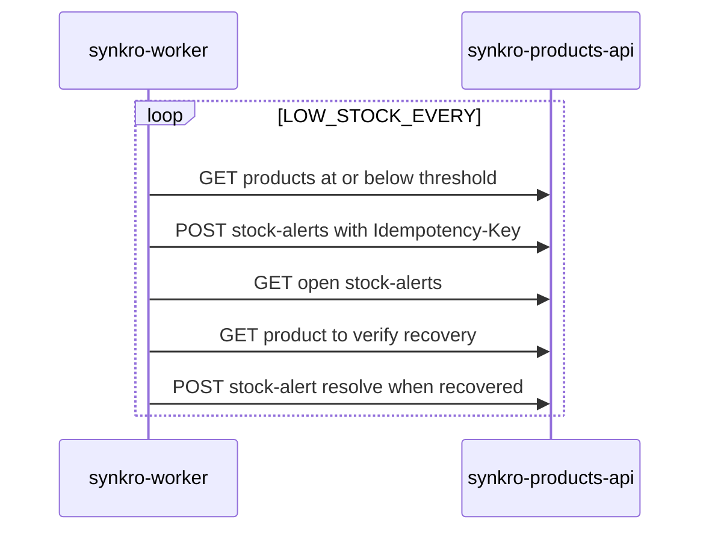

# synkro-worker

> Background worker that opens and resolves low-stock alerts through the Products public API.

Part of the **SynkroTech SAS Sales Management System**. Architecture, decisions and
contracts live in [synkro-docs](https://github.com/code-corhuila/synkro-docs).

**Quick start:** from this root with Go 1.23, supply the Products URL and a valid service token, then run `go run ./cmd/worker`. See [Getting started](#getting-started).

## What it does

- Runs the low-stock job on the configured interval.
- Opens alerts for qualifying products and resolves them after verified stock recovery.
- Bounds work, pages, request attempts and total run duration.
- Uses a run identity for correlation/idempotency and preserves uncertain alerts.
- Owns no database and publishes no HTTP port.

## Where it fits



Products owns alert state and authorization. The Worker is a hexagonal scheduled process; outbound HTTP is confined to its Products adapter.

## Tech stack

| Component | Choice |
|---|---|
| Language | Go 1.23; standard library |
| Architecture | Domain, application ports/use case, scheduler and HTTP adapter |
| Runtime | Docker background process; no published port |
| Verification | Go tests and opt-in real-Products acceptance |

## Dependencies

| Depends on | Purpose | Configuration |
|---|---|---|
| synkro-products-api | Product/alert reads, alert opening and resolution | PRODUCTS_API_URL |
| Auth-issued SERVICE identity | products:read, stock-alerts:read/write | SERVICE_TOKEN; root uses WORKER_SERVICE_TOKEN |

## Getting started

From this root in **PowerShell or Bash**, with Go 1.23, Products running and SERVICE_TOKEN / PRODUCTS_API_URL supplied securely:

```text
go run ./cmd/worker
```

The URL must be reachable from the process. An internal Docker DNS address is for a container on platform. Ctrl+C initiates orderly shutdown.

For the complete platform, start from [synkro-infra-postgres](https://github.com/code-corhuila/synkro-infra-postgres).

## Configuration

The committed [.env.example](.env.example) is the configuration inventory.
Its values are examples; required inputs and defaults follow its comments and the
owning implementation. Keep real secrets in protected local files.

| Variable | Purpose |
|---|---|
| `SERVICE_TOKEN` | Service identity or token lifetime; see the configuration comments |
| `PRODUCTS_API_URL` | Connection address, origin or build-time entry point |
| `LOW_STOCK_EVERY` | Low stock every |
| `LOW_STOCK_THRESHOLD` | Low stock threshold |
| `BATCH_SIZE` | Batch size |
| `LOW_STOCK_MAX_PAGES` | Low stock max pages |
| `RUN_TIMEOUT` | Run timeout |
| `HTTP_TIMEOUT` | Http timeout |
| `HTTP_ATTEMPTS` | Http attempts |

## Interface

| Job | Schedule | Effect |
|---|---|---|
| Low-stock alerts | LOW_STOCK_EVERY | Opens/reuses alerts and resolves verified recoveries |

An unreadable product is not treated as recovered. The shared per-run work budget and repeated-opening behavior are detailed below.

## Project structure

```text
cmd/worker/             entry and shutdown
internal/domain/        job rules
internal/application/   use case and ports
internal/adapter/       scheduler and Products HTTP adapter
internal/config/        input validation
internal/acceptance/    optional real-service checks
deploy/                 container and Compose
docs/                   job contract and verification detail
```

## Testing

```text
go vet ./...
go test -race ./...
```

The race detector needs cgo. On Windows without a C toolchain, use the source-documented container approach. Real-Products acceptance is opt-in with its acceptance build tag and TEST_* inputs; ordinary unit success does not prove it ran.

## Branching and contributing

Use a `feat/`, `fix/` or `chore/` child branch and a PR into `develop`.
Permanent branches are `develop`, `qa` and `main`; none accepts direct commits.
Promote through a `qa-<description>` or release child with `git cherry-pick -x`.
`main` requires approval from `ariel5253`. Use English Conventional Commits.
See [Git conventions](https://github.com/code-corhuila/synkro-docs/blob/main/00-governance/git-conventions.md).

## Further documentation

- [Low stock job](docs/low-stock-job.md).
- [Configuration details](docs/configuration-details.md).
- [Known limitations](docs/known-limitations.md).
- [Local development](docs/local-development.md).
- [Testing](docs/testing.md).
- [Domain rules](https://github.com/code-corhuila/synkro-docs/blob/main/02-domain/entities-and-rules.md), [contracts](https://github.com/code-corhuila/synkro-docs/tree/main/07-api/contracts/openapi) and [testing strategy](https://github.com/code-corhuila/synkro-docs/blob/main/11-quality/testing-strategy.md).

<!-- Preserve previously published README section links. -->
<a id="what-the-worker-does"></a>
<a id="run-identity-and-idempotency-key"></a>
<a id="a-resolved-answer-to-an-opening"></a>
<a id="work-budget-of-a-run"></a>
<a id="errors-retries-and-shutdown"></a>
<a id="known-limitations"></a>
<a id="branching"></a>
<a id="running-locally"></a>
<a id="running-the-tests"></a>
<a id="opt-in-acceptance-against-a-real-products"></a>
